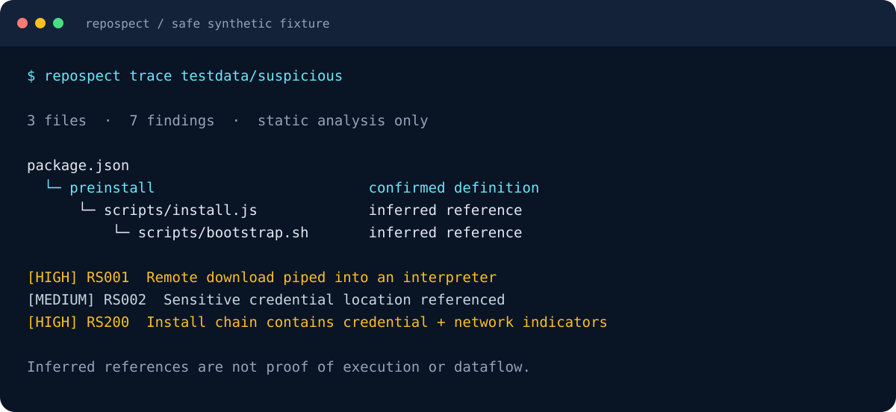

# Ibrahim Abu El Ruzz

**Product Engineer | Senior Software Engineer | AI & Security Systems**

I build tools that make complex systems easier to inspect, reason about, and use—from repository security analysis to local document intelligence and AI workflow infrastructure.

[Featured projects](#featured-engineering-projects) · [Engineering approach](#engineering-approach) · [Open source](#open-source--collaboration) · [GitHub](https://github.com/IAbuElRuzz)

## Project spotlight

Six starting points across security, AI, and developer tooling:

| Project | Explore |
| :--- | :--- |
| **[RepoSpect](https://github.com/IAbuElRuzz/RepoSpect)** | Inspect repository behavior and trace suspicious file references before execution. |
| **[RepoSentry](https://github.com/IAbuElRuzz/RepoSentry)** | Triage source, workflow, and dependency-manifest security signals. |
| **[RepoSignal](https://github.com/IAbuElRuzz/RepoSignal)** | Find actionable documentation and repository maintenance improvements. |
| **[PDF-Rag](https://github.com/IAbuElRuzz/PDF-Rag)** | Explore PDF retrieval and question answering with local models. |
| **[StoryOS](https://github.com/IAbuElRuzz/StoryOS)** | Compile YAML stories into cached, dependency-aware video assets. |
| **[llm-orca](https://github.com/IAbuElRuzz/llm-orca)** | Route prompts, pack context, and compare local coding assistants. |

## Featured engineering projects

### [RepoSpect](https://github.com/IAbuElRuzz/RepoSpect) · Inspect before you execute

**Review unfamiliar repositories before installing or running their code.** A local-first security CLI that surfaces suspicious behavior, dependency risks, and potential attack chains through static evidence.

- Connects npm lifecycle hooks and literal file references; correlates credential and network indicators across referenced files.
- Inspects installation scripts, dependency manifests, credential patterns, and initial container, CI, and agent configuration risks.
- Produces text, JSON, SARIF, dependency inventories, and graph reports with redacted evidence and explicit coverage limits.
- Bounds file and archive processing; local static scans do not execute inspected code.

**Go 1.24+ · Early development.** Tracing uses lexical rules and inferred references; general dataflow analysis and OCI image scanning remain planned.

```sh
# From the RepoSpect source directory; requires Go 1.24+.
go build -trimpath -o bin/repospect ./cmd/repospect
./bin/repospect scan /path/to/repository --offline
./bin/repospect trace testdata/suspicious --offline
```

[](https://github.com/IAbuElRuzz/RepoSpect#follow-the-execution-path)

*Selected results from the project's inert fixture, reproduced as a static illustration. References do not prove execution or credential dataflow.*

[Quick start](https://github.com/IAbuElRuzz/RepoSpect#try-it-in-a-minute) · [Architecture](https://github.com/IAbuElRuzz/RepoSpect/blob/main/docs/ARCHITECTURE.md) · [Threat model](https://github.com/IAbuElRuzz/RepoSpect/blob/main/docs/THREAT_MODEL.md) · [Limits](https://github.com/IAbuElRuzz/RepoSpect/blob/main/docs/LIMITATIONS.md)

---

### [RepoSentry](https://github.com/IAbuElRuzz/RepoSentry) · Repository security triage

**Turn a local repository into a reviewable security report.** A compact Python CLI for source, workflow, and dependency-manifest signals.

- Flags credential patterns, sensitive filenames, download-to-shell commands, dynamic evaluation, and npm lifecycle scripts.
- Reviews direct URL dependencies and selected GitHub Actions permission and pinning risks.
- Optionally queries PyPI and npm metadata for unresolved, yanked, or deprecated packages; exports Markdown or JSON.

**Python 3.11+ · Standard library runtime · v0.1 alpha.** Focused rule-based triage, distinct from RepoSpect's cross-file tracing. Findings require human review.

[Install & CLI examples](https://github.com/IAbuElRuzz/RepoSentry#install-and-run) · [Scanner](https://github.com/IAbuElRuzz/RepoSentry/blob/main/src/reposentry/scanner.py) · [Tests](https://github.com/IAbuElRuzz/RepoSentry/tree/main/tests)

---

### [RepoSignal](https://github.com/IAbuElRuzz/RepoSignal) · Repository maintenance intelligence

**Help maintainers find concrete improvements in their public repositories.** An evidence-based GitHub auditor for discoverability, documentation, and maintenance signals.

- Checks descriptions, topics, and root-level README, license, security, and contribution files.
- Identifies selected runtime artifacts accidentally tracked at the repository root.
- Separates GitHub data acquisition, audit rules, and Markdown reporting behind a repeatable CLI.

**Python 3.11+ · GitHub REST API · v0.1.** Audits public repository signals; it does not scan source for malware or assess people.

[Quick start](https://github.com/IAbuElRuzz/RepoSignal#quick-start) · [Audit rules](https://github.com/IAbuElRuzz/RepoSignal/blob/main/src/reposignal/audit.py) · [Tests](https://github.com/IAbuElRuzz/RepoSignal/tree/main/tests)

---

### [PDF-Rag](https://github.com/IAbuElRuzz/PDF-Rag) · Local document intelligence

**Ask questions over PDF collections using a local language model.** A retrieval-augmented terminal application connecting document extraction, semantic retrieval, and answer generation.

- Extracts PDF text with PyPDF2 or an alternative pdfplumber pipeline; splits it into overlapping chunks.
- Embeds chunks with `all-MiniLM-L6-v2` and retrieves context from a persisted FAISS index.
- Uses LangChain RetrievalQA with Ollama; the pdfplumber variant displays retrieved context for inspection.

**Python · LangChain · Hugging Face · FAISS · Ollama · Prototype.** Setup and dependency compatibility need hardening; the PyPDF2 entry point is `run.py`.

[Pipeline source](https://github.com/IAbuElRuzz/PDF-Rag/blob/main/run.py) · [Context inspection variant](https://github.com/IAbuElRuzz/PDF-Rag/blob/main/run_pdf_plumber.py) · [Project documentation](https://github.com/IAbuElRuzz/PDF-Rag#readme)

---

### [StoryOS](https://github.com/IAbuElRuzz/StoryOS) · Video as a build graph

**Compile YAML stories into reusable video assets.** A video pipeline prototype applying build-system ideas to AI media workflows.

- Compiles scenes into video, voice, merge, and concatenation nodes with hashes derived from parameters and input hashes.
- Runs independent nodes in a thread pool, reuses cached assets, and records per-node cache status in a JSON manifest.
- Includes a Runway API adapter, FFmpeg video assembly, and a mock rendering mode for development.

**Python · YAML · Runway SDK · FFmpeg · v0.1 prototype.** Voice output is currently an FFmpeg tone placeholder; ElevenLabs integration is planned. Deterministic cache keys do not imply deterministic AI output.

[Workflow & examples](https://github.com/IAbuElRuzz/StoryOS#quick-start) · [Compiler](https://github.com/IAbuElRuzz/StoryOS/blob/main/app/compiler/compiler.py) · [Executor](https://github.com/IAbuElRuzz/StoryOS/blob/main/app/orchestrator/executor.py)

## Engineering expertise

| Domain | Evidence in my work |
| :--- | :--- |
| **AI & workflow systems** | PDF retrieval, embeddings, local LLM integration; StoryOS asset orchestration; [llm-orca](https://github.com/IAbuElRuzz/llm-orca) provider routing, context packing, and transcript capture. |
| **Security engineering** | Static repository analysis, installation risks, dependency metadata, credential indicators, threat modeling, and bounded input handling in RepoSpect and RepoSentry. |
| **Software engineering** | Go and Python CLIs, TypeScript developer tools, separation of acquisition/rules/reporting, testable components; FastAPI and SQLAlchemy in [crypto-ai-agent](https://github.com/IAbuElRuzz/crypto-ai-agent). |
| **Infrastructure & developer experience** | GitHub Actions, source-build workflows, machine-readable reports, container configuration checks, and incremental asset processing. |

Current interests: agentic workflows, software supply-chain protection, secure architecture, and reliable backend systems.

## Engineering approach

- **Make trust boundaries explicit.** Inspect unfamiliar code without executing it; document what analysis can and cannot establish.
- **Keep systems understandable.** Prefer small components, clear interfaces, and evidence that a reviewer can follow.
- **Design toward production readiness.** Test failure paths, expose incomplete coverage, and make operational behavior observable.
- **Make AI useful and inspectable.** Surface retrieval context, preserve workflow traces, and evaluate outcomes before expanding scope.
- **Measure the outcome.** Favor reproducible examples, regression fixtures, and actionable reports over claims without evidence.

## Open source & collaboration

Explore [RepoSpect's contribution guide](https://github.com/IAbuElRuzz/RepoSpect/blob/main/CONTRIBUTING.md), [RepoSentry's releases](https://github.com/IAbuElRuzz/RepoSentry/releases), and the source and tests linked above. I welcome technical collaboration on detection coverage, developer tooling, retrieval quality, and dependable AI workflows.

For project discussions, use the relevant repository's Issues. For more of my work, visit [my GitHub profile](https://github.com/IAbuElRuzz).

<details>
<summary>Coding activity · WakaTime</summary>

Historical coding-time snapshot; activity duration is not a measure of software quality. Updated by the existing profile workflow.

<!--START_SECTION:waka-->

```txt
From: 16 February 2022 - To: 11 November 2026

Total Time: 472 hrs 17 mins

TypeScript         128 hrs 24 mins >>>>>>>------------------   27.19 %
Python             97 hrs 5 mins   >>>>>--------------------   20.56 %
JavaScript         83 hrs 52 mins  >>>>---------------------   17.76 %
JSON               38 hrs 32 mins  >>-----------------------   08.16 %
Bash               29 hrs 13 mins  >>-----------------------   06.19 %
```

<!--END_SECTION:waka-->

</details>
